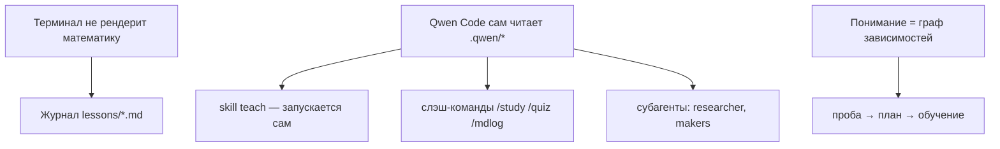

# Как пользоваться средой обучения


> [!quote] Вы

просмотри проект и расскажи как мне пользоваться

> [!abstract] Учитель

## Как пользоваться средой `learn`

### Три безусловные истины, из которых всё следует

1. **Qwen Code сам читает конфиг проекта.** Всё, что лежит в `.qwen/`, подхватывается автоматически при запуске в этой папке. Здесь нет сборки, сервера или установки — «среда» и есть эти файлы. Единственный исполняемый код — два скрипта в `scripts/`.
2. **Терминал плохо подходит для чтения длинных объяснений и математики.** Он не рендерит `$...$`, картинки и таблицы. Значит, урок надо зеркалить в файл, который читаешь где-то ещё (Obsidian). Отсюда — журнал.
3. **Понимание — это граф связей в голове, а не список фактов.** Факт «сам себя держит», только если висит на том, что уже принято как верное. Отсюда форма: сначала безусловные истины, потом производное.

### Как это собрано из родных механизмов Qwen Code



- `QWEN.md` — контекст, который модель видит всегда: «режим по умолчанию — обучение, отвечай по-русски».
- `.qwen/skills/*` — инструкции, которые модель подхватывает сама по триггеру. `teach` — ядро; `quiz`, `visualize`, `learn-log` — вспомогательные.
- `.qwen/commands/*` — слэш-команды, которые запускает ученик: `/study`, `/quiz`, `/mdlog`.
- `.qwen/agents/*` — субагенты (изолированный контекст, свои инструменты): `researcher` — проверка фактов и карта темы; `mermaid-maker` / `svg-maker` — рисуют PNG.

### Старт

```bash
cd ~/Documents/learn
qwen
```

Дальше двумя способами: просто говорить («объясни, как работает event loop» — `teach` включится сам) или командами `/study <тема>`, `/quiz <тема>`, `/mdlog <путь>`.

### Ритм сессии (проба → план → обучение)

1. **Проба.** Оценённые вопросы ищут *край* понимания; отдельно выясняется учебная цель. «Не знаю» — ценная информация, а не провал.
2. **План.** `researcher` очерчивает тему, показывается прозаический план и mermaid-карта зависимостей. **Здесь я останавливаюсь и жду «ок»** — это точка контроля охвата.
3. **Обучение.** Узел за узлом: мотивирую → устанавливаю → связываю → проверяю quiz-ом.

### Журнал и картинки

- Журнал: `lessons/<тема>.md`, активный файл хранится в `.qwen/learn-active-log`, пишется только в конец. В Obsidian нативно рендерятся markdown, `$...$` и картинки.
- Картинки: когда идея яснее как картинка, `visualize` через makers рисует PNG в `viz/`, вставка — ``.

### Настройка и диагностика

- Система написана под одного ученика: правь `.qwen/skills/teach/SKILL.md` свободно — сколько зондировать, сократически или излагающе, насколько крупными узлами идти.
- Нужен Node (скрипты) и Chrome (только рендер диаграмм; Chrome на месте, иначе задай `CHROME_PATH`).
- Диаграмма не рендерится — проверь Chrome; журнал не пишется — `node scripts/log.mjs init "<тема>"`; субагент не пишет файлы — не запускай сессию в plan-режиме.


> [!abstract] Учитель

### Настройка Obsidian

- Obsidian 1.13.7 установлен; папка `~/Documents/learn` подключена как vault (в проекте появилась `.obsidian/`).
- Математика (`$...$`, `$$...$$`) и блоки `mermaid` рендерятся нативно, без плагинов.
- Картинки из папки `viz/` вставляются ссылкой ``.

Карта артефактов учебной сессии:


