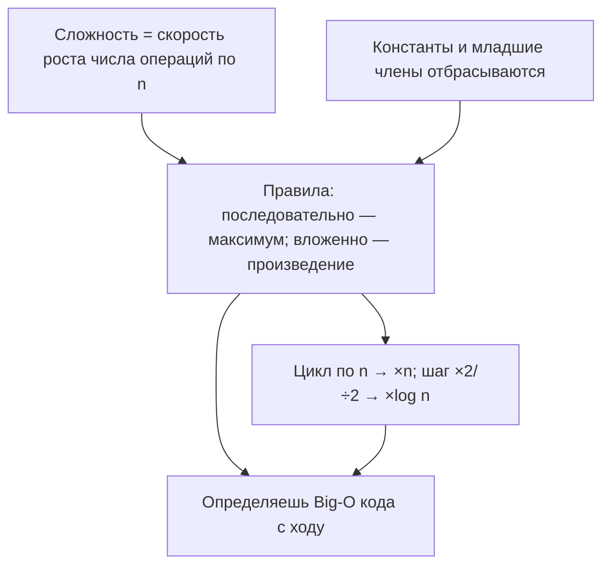
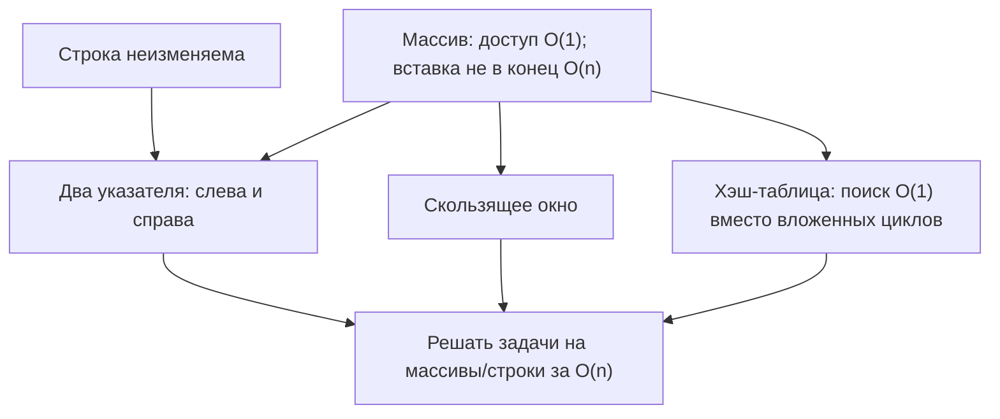
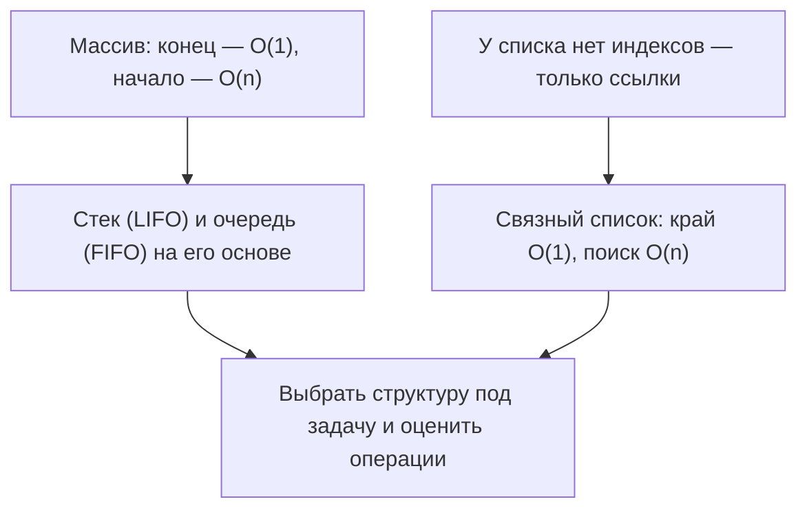

# Подготовка к собеседованию: алгоритмы и структуры данных


> [!quote] Вы

/study — подготовка к собеседованию по алгоритмам и структурам данных

Цель: Middle Frontend. Стартовый блок: основы сложности (Big-O).

> [!abstract] Учитель

Начинаем фазу «проба»: серия коротких оценённых вопросов, чтобы найти край понимания. Сложность вопросов подстраивается под ответы.

> [!question] Вопрос 1

Что именно описывает запись $O(n)$?

- Точное число операций, которое выполнит алгоритм
- Как время работы растёт с размером входа, с точностью до постоянного множителя
- Фактическое время выполнения в секундах на данной машине
- Наибольший размер входа, при котором алгоритм ещё работает


> [!failure] Ответ 1

Выбран вариант «Точное число операций». Неверно. Правильный — «Как время работы растёт с размером входа, с точностью до постоянного множителя»: $O$-нотация отбрасывает постоянные множители и младшие члены и говорит только о скорости роста ($3n+7$ и $100n$ — обе $O(n)$).

> [!question] Вопрос 2

Алгоритм A выполняет $2n$ операций, алгоритм B — $5n$. Что можно сказать об их сложности?

- У A сложность $O(2n)$, у B — $O(5n)$, и это разные сложности
- $O(2n)$ быстрее $O(5n)$, потому что операций меньше
- Обе — $O(n)$: постоянный множитель отбрасывают
- Их сложности сравнимы только по реальному времени в секундах


> [!success] Ответ 2

«Обе — $O(n)$». Верно: постоянный множитель отбрасывается, $2n$ и $5n$ — обе $O(n)$. $O$-нотация про скорость роста, а не про точный счёт.

> [!question] Вопрос 3

Внешний цикл выполняется $n$ раз; внутри него — цикл ровно на 1000 итераций (число фиксировано, не зависит от $n$). Какова сложность алгоритма по $n$?

- $O(n)$
- $O(n^2)$
- $O(n \log n)$
- $O(1)$


> [!failure] Ответ 3

Выбран «$O(n \log n)$». Неверно. Правильно — $O(n)$: внутренний цикл делает 1000 итераций независимо от $n$ (постоянная работа), всего $\approx 1000n$ операций, постоянный множитель отбрасывается. Вывод пока: отбрасывание констант знает (в.2 ✓), но применять его к разбору циклов пока не выходит (в.1 и в.3 ✗).

> [!question] Вопрос 4

Два вложенных цикла: внешний выполняется $n$ раз, и внутренний — тоже $n$ раз (оба зависят от $n$). Какова сложность?

- $O(n)$
- $O(\log n)$
- $O(n^2)$
- $O(n \log n)$


> [!quote] Вы

остановись пока. мне нужно понять, зачем нам тут obsidian?

> [!abstract] Учитель

### Зачем Obsidian

**Истина:** учиться — значит читать длинные объяснения с формулами, картинками и диаграммами и возвращаться к ним позже. Спросим: где это читать?

- **Терминал** печатает текст потоком, не рисует `$...$`, картинки и mermaid, а ушедшие строки не вернуть.
- **Файл на диске** сам по себе тоже текст, пока его никто не отрендерил. Нужен **рендерер** markdown.

Obsidian — этот рендерер: нативно рисует формулы, mermaid и картинки; работает локально (vault = папка проекта, без аккаунта и сервера).

Разделение труда: **терминал** — где действуешь (отвечаешь, запускаешь `/study`); **Obsidian** — где читаешь (урок зеркалится в `lessons/*.md`, рисунки — в `viz/*.png`). Поэтому `teach` дописывает урок в журнал, а `visualize` кладёт рисунки в `viz/`; журнал append-only — растёт в личный конспект.

Проба по Big-O приостановлена. Успели найти: пол — отбрасывание констант (в.2 ✓); потолок — применение к разбору циклов (в.1 и в.3 ✗).


> [!quote] Вы

продолжим с разбора цикла

> [!abstract] Учитель

### Фаза 2 — План (сложность / разбор циклов)

Проба нашла край: константы отбрасывать умеешь (в.2 ✓), а разбирать код на циклы — нет (в.1 и в.3 ✗). Урок целится в разбор циклов.

**Порядок:**
1. Корень-определение: что измеряет $O$ — скорость роста числа операций по $n$ (не точный счёт, не секунды). Чиним в.1.
2. Опора: константы и младшие члены отбрасываются (в.2 ✓).
3. Правила подсчёта: последовательно — максимум; вложенно — произведение.
4. Вложенный цикл с константным внутренним ($n \times 1000 \to O(n)$). Чиним в.3.
5. Логарифм: шаг $\times 2$ или $\div 2$ → $O(\log n)$.
6. Применение: 3–4 куска кода — назвать $O$.

Рисунок: на узле 1 — график роста ($n$ vs $n^2$ vs $\log n$) через `svg-maker`.

**Карта зависимостей:**



Ожидание одобрения плана.


> [!abstract] Учитель

### Узел 1. Что измеряет сложность

**Зачем:** два алгоритма под одну задачу — какой быстрее? Секунды ненадёжны (машина, язык, нагрузка). Нужна мера, устойчивая к машине: как растёт объём работы при росте размера входа $n$.

**Определение.** $f(n) = O(g(n))$ означает: $\exists C>0,\ \exists n_0:\ f(n) \le C\,g(n)$ для всех $n\ge n_0$.

Удержать три вещи:
- это **верхняя оценка** («не быстрее»), а не равенство; знак «$=$» односторонний ($O(n)=O(n^2)$, но не обратно);
- $O(g(n))$ — **класс функций**, а не одна функция;
- «с точностью до множителя» — прямое следствие определения (раз есть $C$, число перед $g$ неважно) — то самое отбрасывание констант (в.2 ✓).

Рост против точного числа — глазами:


**Итог узла:** $O$ — про скорость роста; верхняя оценка; класс функций.

> [!question] Вопрос 5

Что означает запись $f(n) = O(g(n))$?

- Что $f(n)$ и $g(n)$ равны при всех $n$
- Что $f(n)$ растёт не быстрее $g(n)$ с точностью до постоянного множителя, начиная с достаточно больших $n$
- Что $f(n)$ растёт не медленнее $g(n)$, начиная с достаточно больших $n$
- Что $f(n) \le g(n)$ при всех $n$ без исключений


> [!failure] Ответ 5

Выбран «f и g равны при всех n». Неверно — и это ключ ко всему узлу: знак «=» в $f(n)=O(g(n))$ — не равенство, а одностороннее отношение «растёт не быстрее». Пример: $3n+5$ и $n$ не равны ни при одном $n$, но $3n+5=O(n)$: достаточно взять $C=4,\ n_0=5$ ($3n+5\le 4n$ для всех $n\ge5$).

> [!abstract] Учитель

Чиним узел через конкретику: алгоритм делает $3n+5$ операций. Удвоим $n$ — работа почти удвоится; у $n$ тоже. По характеру роста они одинаковы, поэтому пишут $3n+5=O(n)$. Знак «=» — историческая условность, читается «не быстрее по порядку»; определение лишь фиксирует это формально ($C=4,\ n_0=5$).

> [!question] Вопрос 6

Алгоритм выполняет $3n+5$ операций. Что из этого верно?

- $3n+5$ и $n$ должны быть равны при всех $n$
- $3n+5 = O(n^2)$, но не $O(n)$
- $3n+5 = O(n)$
- $3n+5$ нельзя записать через $O$ из-за слагаемого $5$


> [!success] Ответ 6

«$3n+5 = O(n)$». Верно — по характеру роста линейная функция; «=» читается «не быстрее по порядку». Узел 1 встал.

> [!abstract] Учитель

### Узел 2. Правила подсчёта по коду

**Правило произведения (вложенные циклы):** множители перемножаются — внешний по $n$, внутренний по $m$ → $O(n\cdot m)$; оба по $n$ → $O(n^2)$. Почему: внутренний цикл повторяется целиком на каждой из $n$ итераций внешнего → $n\cdot n$.

**Правило суммы (последовательные блоки):** складываем, но в $O$ оставляем максимум: $O(n)+O(n^2)\to O(n^2)$. Почему: при больших $n$ больший член съедает меньший (то же отбрасывание младшего, что и констант).

**Связь:** правило суммы = принцип «отбросить младшее» (в.2 ✓); правило произведения следует из подсчёта числа операций по $n$ (узел 1).

> [!question] Вопрос 7

Блок: сначала один цикл по $n$ (сложность $O(n)$), затем два вложенных цикла по $n$ (сложность $O(n^2)$). Какова сложность всего блока?

- $O(n)$
- $O(n^2)$
- $O(n^3)$
- $O(n^2 + n)$


> [!failure] Ответ 7

Выбран «$O(n^2+n)$». Неверно. Правильно — $O(n^2)$: правило суммы оставляет максимум. Слагаемое $n$ — младший член, при больших $n$ оно тонет (при $n=1000$: $n^2=1\,000\,000$, $+n=+1000$ — это $+0{,}1\%$). То же правило, что и отбрасывание $+5$ в вопросе 6.

> [!abstract] Учитель

Правило суммы = правило «отбросить младшее», которое ты уже применил в вопросе 6. Проверяем на числах.

> [!question] Вопрос 8

Алгоритм делает $n^2 + 100n$ операций. Какова его сложность?

- $O(n^2)$
- $O(n^2 + 100n)$
- $O(n^3)$
- $O(n)$


> [!success] Ответ 8

«$O(n^2)$». Верно — младший член отброшен. Правило суммы встало.

> [!abstract] Учитель

### Узел 3. Перемножаем зависимость от n, а не «вложенность»

Правило произведения нельзя применять механически («два цикла → $n^2$»). Перемножаем **зависимость числа итераций от $n$**. Внешний по $n$, внутренний фиксированный на 1000 → внутренний даёт $O(1)$, итог $n\cdot1=O(n)$. Цикл, чьё число итераций не зависит от $n$, класс не поднимает. Это правило произведения (узел 2) + отбрасывание констант (в.2 ✓).

> [!question] Вопрос 9

Внешний цикл выполняется $n$ раз, внутренний — ровно 1000 раз (фиксировано). Какова сложность?

- $O(n)$
- $O(n^2)$
- $O(n \log n)$
- $O(n + 1000)$


> [!success] Ответ 9

«$O(n)$». Верно — внутренний цикл константный ($\times1$). Исходный промах в.3 исправлен.

> [!abstract] Учитель

### Узел 4. Откуда берётся $O(\log n)$

Если переменная цикла умножается/делится на 2 каждый шаг (`i *= 2`), число итераций ≈ $\log_2 n$. Почему: сколько раз надо удвоить 1, чтобы дойти до $n$ — столько, сколько степеней двойки укладывается в $n$: $2^k \approx n \Rightarrow k \approx \log_2 n$. Это по-прежнему подсчёт итераций по $n$ (узел 1); на графике роста — почти лежащая кривая.

> [!question] Вопрос 10

Цикл: `for (let i = 1; i < n; i *= 2) { ... }`. Какова его сложность?

- $O(n)$
- $O(n \log n)$
- $O(\log n)$
- $O(1)$


> [!failure] Ответ 10

Выбран «$O(n)$». Неверно. Правильно — $O(\log n)$: переменная цикла `i *= 2` удваивается, поэтому шагов ≈ $\log_2 n$, а не $n$.

> [!abstract] Учитель

Считаем итерации `i *= 2` конкретно: $n=16$ → $i=1,2,4,8$ → 4 шага ($=\log_2 16$); $n=1000$ → 10 шагов; $n=10^6$ → 20. Удвоение добирается до $n$ за $\log_2 n$ шагов. Обычный `i++` дал бы $n$.

> [!question] Вопрос 11

Сколько примерно итераций выполнит цикл `for (let i = 1; i < 1000; i *= 2)`?

- 1000
- 500
- 10
- 100


> [!failure] Ответ 11

Выбран «1000». Неверно. Правильно — **10** итераций. Удвоение не идёт по одному шагу, а прыгает вдвое дальше, поэтому доскакивает до $n$ за ≈ $\log_2 n$ шагов.

> [!abstract] Учитель

Считаем вслух для $n=16$, выписывая `i`: 1→тело, 2→тело, 4→тело, 8→тело, 16→стоп. Тело выполнилось **4** раза, а не 16. Для $n=16$ → 4, для $n=1000$ → 10, для $10^6$ → 20; всегда ≈ $\log_2 n$.

> [!question] Вопрос 12

Цикл `for (let i = 1; i < 16; i *= 2)` — сколько раз выполнится тело?

- 16
- 8
- 4
- 2


> [!success] Ответ 12

«4». Верно: $i$ проходит 1,2,4,8, на 16 цикл стоп → 4 шага ≈ $\log_2 n$ → $O(\log n)$. Узел 4 (самый упрямый) лёг.

> [!abstract] Учитель

### Узел 5 (применение). Назвать $O$ по коду

```js
for (let i = 0; i < n; i++) sum += i;                        // O(n)
for (let i = 0; i < n; i++) for (let j = 0; j < n; j++) …    // O(n^2)
for (let i = 0; i < n; i++) for (let j = 1; j < n; j *= 2) … // ?
```

Вложенные циклы перемножают сложности: внешний $n$, внутренний `j *= 2` → $\log n$, произведение → $O(n\log n)$.

> [!question] Вопрос 13

Сложность фрагмента: внешний цикл по $n$, внутри — цикл с `j *= 2` до $n$?

- $O(n)$
- $O(n \log n)$
- $O(n^2)$
- $O(\log n)$


> [!success] Ответ 13

«$O(n \log n)$». Верно: перемножили $n$ и $\log n$. Цель сессии достигнута.

> [!abstract] Учитель

### Итог сессии по Big-O

Граф построен целиком:
- **Узел 1.** Что такое $O$ (скорость роста, верхняя оценка, класс функций). Промах: читал «=» как равенство → исправлен.
- **Узел 2.** Правила суммы (максимум) и произведения. Промах: оставлял $O(n^2+n)$ → исправлен.
- **Узел 3.** Перемножаем зависимость от $n$, а не вложенность ($n\times1000\to O(n)$) — исходный промах в.3.
- **Узел 4.** Откуда $O(\log n)$ (шаг $\times2$/$\div2$). Встал на конкретном пересчёте $n=16$.
- **Узел 5.** Назвать $O$ по коду, включая $O(n\log n)$.

**Итог:** с 4 промахов в пробе → уверенно называешь $O$ для линейных, вложенных, константных и логарифмических циклов. Ключ: $O$ — про скорость роста; считаем зависимость от $n$, младшее отбрасываем.

Следующие возможные блоки: массивы/строки/хэш-таблицы, линейные структуры, деревья и графы.


> [!quote] Вы

Давай следующий блок — массивы и строки

> [!abstract] Учитель

### Блок 2: массивы и строки

Фаза «проба»: серия вопросов, чтобы найти край понимания по теме; сложность подстраивается под ответы.

> [!question] Вопрос 14

Динамический массив из $n$ элементов. Какова сложность **вставки в начало** (например, `arr.unshift(x)`)?

- $O(1)$
- $O(n)$
- $O(\log n)$
- $O(n \log n)$


> [!success] Ответ 14

«$O(n)$». Верно: вставка в начало сдвигает все $n$ элементов вправо. (Доступ по индексу — $O(1)$; вставка/удаление не в конце — линейны.)

> [!question] Вопрос 15

Добавление в **конец** динамического массива — `arr.push(x)`. Какая сложность (рассматриваем худшую оценку на одну операцию)?

- $O(1)$
- $O(\log n)$
- $O(1)$ амортизированно
- $O(n)$


> [!failure] Ответ 15

Выбран «$O(1)$». Неверно. Правильно — **$O(1)$ амортизированно**: обычно в конце есть свободная ячейка (честный $O(1)$), но при переполнении массив растёт и копирует все $n$ элементов ($O(n)$ для того одного push). Дорогие копирования редки; размазанные по серии, дают в среднем $O(1)$. «Амортизированно» = усреднение по последовательности операций, а не по входам.

> [!question] Вопрос 16

Почему `push` называют $O(1)$ *амортизированно*, а не просто $O(1)$?

- Потому что иногда массив переполнен, и все элементы копируются в больший массив
- Потому что `push` иногда удаляет элементы
- Потому что доступ по индексу $O(1)$
- Потому что `push` сортирует массив


> [!failure] Ответ 16

Выбран «push иногда удаляет элементы». Неверно — `push` никогда не удаляет. Правильно: при переполнении массив растёт и копирует все элементы в больший блок.

> [!abstract] Учитель

Пошагово: массив вмещает 4, в нём 4. `push` → выделяется блок на 8, копируются 4 старых элемента ($O(n)$), кладётся новый. Затем 4 свободных места → следующие push дёшевы ($O(1)$). Копирование — только в момент расширения, поэтому в среднем $O(1)$ амортизированно.

> [!question] Вопрос 17

Массив вмещает 4 элемента, и в нём уже 4. Мы делаем `push`. Что произойдёт внутри?

- Элемент запишется в уже свободную ячейку
- Массив выделит блок побольше и скопирует 4 старых элемента
- `push` удалит один старый элемент, чтобы освободить место
- `push` выполнит сортировку


> [!success] Ответ 17

«Выделит блок и скопирует 4 старых элемента». Верно: при переполнении массив растёт и копирует все элементы — это и есть причина $O(1)$ амортизированно.

> [!question] Вопрос 18

Что верно про строки в JS?

- Строка неизменяема: символ нельзя поменять на месте, любая «правка» создаёт новую строку
- Строка — это изменяемый массив символов
- Доступ к символу `s[i]` стоит $O(n)$
- Длина строки `s.length` считается за $O(n)$


> [!failure] Ответ 18

Выбран «Строка — это изменяемый массив символов». Неверно: строки в JS **неизменяемы** — `s[0]='x'` молча ничего не делает, любая «правка» создаёт новую строку. Чтение `s[i]` и `s.length` — $O(1)$; «правка» = копирование, $O(n)$.

> [!abstract] Учитель

Вывод: накапливать строку по символу в цикле невыгодно (каждый `s += c` заново копирует накопленное → суммарно $O(n^2)$). Эффективный приём — собрать в массиве и склеить один раз.

> [!question] Вопрос 19

Строки неизменяемы. Как эффективно собрать строку из $n$ символов в цикле?

- Прибавлять символ к строке: `s += c` на каждом шаге
- Накапливать символы в массиве и в конце вызвать `.join('')`
- Менять символы на месте: `s[i] = c`
- Использовать вложенные циклы и `slice`


> [!success] Ответ 19

«Массив + `.join('')`». Верно: склеиваем один раз → $O(n)$; `s += c` в цикле наивно даёт $O(n^2)$.

> [!abstract] Учитель

### Фаза 2 — План (блок «массивы и строки»)

Проба: базовые сложности массивов/строк знаешь частично (промахи — амортизация `push` и неизменяемость строк; оба исправлены). Дальше — приёмы.

1. **Два указателя** (слева/справа): разворот, палиндром, пара с заданной суммой в отсортированном массиве.
2. **Скользящее окно**: максимальная сумма $k$ подряд; самая длинная подстрока без повторов.
3. **Хэш-таблица для $O(1)$-поиска**: two-sum в несортированном массиве, пересечение массивов — вместо $O(n^2)$.

**Карта:**



Ожидание одобрения плана.


> [!abstract] Учитель

### Приём 1. Два указателя

**Зачем:** «палиндром?», «пара с суммой $S$ в отсортированном массиве» — наивно $O(n^2)$, хотим $O(n)$ без лишней памяти.

**Установи:** указатели $i$ (начало) и $j$ (конец) движутся навстречу.
- Палиндром: пока $i<j$, сравниваем $s[i]$ и $s[j]$; равны → внутрь; не равны → не палиндром. Время $O(n)$, память $O(1)$.
- Пара с суммой $S$: $arr[i]+arr[j]$; меньше $S$ → двигать $i$, больше $S$ → двигать $j$, равно → нашли.

**Почему:** отсортированность даёт монотонность — малый левый элемент ни с кем правее не станет лучше, значит его можно отбросить. На каждом шаге отбрасываем один элемент → $O(n)$.

**Связь:** опирается на $O(1)$-доступ по индексу (R1).

> [!question] Вопрос 20

Отсортированный массив, ищем пару с суммой $S$. Указатели $i=0$, $j=n-1$. Оказалось, что $arr[i]+arr[j] < S$. Что делать?

- Сдвинуть $i$ вправо ($i{+}{+}$)
- Сдвинуть $j$ влево ($j{-}{-}$)
- Сдвинуть оба навстречу: $i{+}{+}$ и $j{-}{-}$
- Вернуть «пары нет»


> [!success] Ответ 20

«Сдвинуть $i$ вправо». Верно: сумма мала → нужен элемент больше → двигаем левый указатель. Правило двух указателей схвачено.

> [!abstract] Учитель

### Приём 2. Скользящее окно

**Зачем:** «максимальная сумма $k$ подряд», «самая длинная подстрока без повторов» — наивно $O(n\cdot k)$ / $O(n^2)$.

**Установи:** окно `[left, right]` + его агрегат (сумму). Двигаем `right`, добавляя элемент; при нарушении условия двигаем `left`, убирая элемент. Каждый элемент входит/выходит один раз → $O(n)$.
- Максимум суммы $k$ подряд: окно фиксированной ширины; при сдвиге `сумма −= ушедший; сумма += новый`.
- Длиннейшая подстрока без повторов: расширяем окно, при повторе подтягиваем `left`.

**Связь:** опирается на $O(1)$-доступ (R1); держим агрегат и обновляем за $O(1)$.

> [!question] Вопрос 21

Задача: максимальная сумма $k$ подряд идущих элементов. В чём суть скользящего окна?

- Пересчитывать сумму каждого окна заново — это $O(nk)$
- Держать сумму окна и при сдвиге вычитать ушедший элемент, добавлять новый
- Отсортировать массив и взять $k$ наибольших
- Взять каждый $k$-й элемент


> [!success] Ответ 21

«Держать сумму и обновлять». Верно: окно хранит сумму и обновляет её за $O(1)$ вместо пересчёта.

> [!abstract] Учитель

### Приём 3. Хэш-таблица для $O(1)$-поиска

**Зачем:** two-sum в несортированном массиве; два указателя не работают (нет монотонности), перебор пар — $O(n^2)$.

**Установи:** держим `Set` просмотренных значений. Для текущего $x$ проверяем, есть ли в `Set` значение `target - x`; есть → пара найдена; нет → кладём $x$. Поиск/вставка — $O(1)$ в среднем → весь проход $O(n)$.
- Пересечение двух несортированных массивов: один → в `Set`, идём по второму и проверяем принадлежность → $O(n+m)$ вместо $O(n\cdot m)$.

**Связь:** размен памяти на время — $O(n)$ доп. памяти вместо вложенного цикла $O(n^2)$.

> [!question] Вопрос 22

Two-sum в несортированном массиве, цель — $O(n)$. Что делаем?

- Ставим два указателя на концы массива
- Для каждого $x$ делаем ещё один проход по массиву в поисках `target - x`
- Храним просмотренные значения в `Set`; для каждого $x$ проверяем наличие `target - x`
- Сортируем и берём первые два элемента


> [!success] Ответ 22

«Храним просмотренные значения в `Set`…». Верно: поиск в `Set` — $O(1)$ в среднем → весь проход $O(n)$.

> [!abstract] Учитель

### Итог блока «массивы и строки»

- **База:** доступ по индексу $O(1)$; вставка/удаление не в конце $O(n)$; `push` — $O(1)$ амортизированно; строки неизменяемы (сборка — массив + `join`).
- **Приём 1 — два указателя:** навстречу с концов; работает на отсортированном (монотонность). Палиндром, пара с суммой.
- **Приём 2 — скользящее окно:** `[left, right]` + агрегат за $O(1)$. Максимум суммы $k$ подряд, подстрока без повторов.
- **Приём 3 — хэш-таблица:** `Set`/`Map` для $O(1)$-поиска. Two-sum в несортированном, пересечение. Размен памяти на время.

**Как выбирать приём:** концы/отсортированность → два указателя; непрерывный отрезок → скользящее окно; «видели ли это раньше» → хэш-таблица.

Следующий возможный блок: линейные структуры (стек, очередь, связный список), затем деревья и графы.


> [!quote] Вы

Следующий шаг — новый блок: стек/очередь/связный список

> [!abstract] Учитель

### Блок 3: стек, очередь, связный список

Фаза «проба»: серия вопросов, чтобы найти край понимания.

> [!question] Вопрос 23

В JS очередь часто делают на массиве: добавляют `push`, забирают `shift()`. Какова сложность `shift()`?

- $O(1)$
- $O(n)$
- $O(\log n)$
- $O(1)$ амортизированно


> [!success] Ответ 23

«$O(n)$». Верно: `shift()` сдвигает все элементы влево (как `unshift()` с другого конца). «Очередь на массиве с `shift`» — $O(n)$ на извлечение.

> [!question] Вопрос 24

Как в JS сделать очередь с амортизированным $O(1)$ и на добавление, и на извлечение?

- Вести два стека: кладём в один, забираем из другого, перекладывая, когда тот пуст
- Сортировать массив при каждом извлечении
- Использовать `shift()`, но редко
- Копировать массив при каждом извлечении


> [!success] Ответ 24

«Два стека». Верно: кладём в стек A, забираем из B, при пустом B — перекладываем всё из A в B (переворот). Каждый элемент перекладывается максимум дважды → амортизированно $O(1)$. Инсайт: очередь — это «стек, который периодически переворачивают».

> [!question] Вопрос 25

У связного списка какая операция выполняется за $O(1)$ — в отличие от массива?

- Доступ к элементу по индексу
- Вставка/удаление в начало списка
- Поиск элемента по значению
- Вставка в середину по значению


> [!failure] Ответ 25

Выбран «Вставка в середину по значению». Неверно — это $O(n)$: сначала надо дойти по ссылкам до места. Вставка в **начало** — $O(1)$ (перепривязка `head`).

> [!abstract] Учитель

**Ключ:** у списка нет индексов, к узлу идут по ссылкам. Всё решает, есть ли уже ссылка на место:
- доступ по индексу: массив $O(1)$ / список $O(n)$;
- вставка/удаление в начало: массив $O(n)$ / список $O(1)$;
- вставка ПОСЛЕ известного узла: $O(1)$ (`new.next = node.next; node.next = new`);
- вставка в середину по значению: $O(n)$ в обоих (обход до места).

> [!question] Вопрос 26

В односвязном списке из $n$ узлов есть только `head`. Вставка узла в середину списка (по обходу от начала) — какая сложность?

- $O(1)$
- $O(n)$
- $O(n^2)$
- $O(\log n)$


> [!success] Ответ 26

«$O(n)$». Верно: до середины идём по ссылкам; $O(1)$ только при готовой ссылке на узел.

> [!question] Вопрос 27

Как проверить, что строка скобок сбалансирована (например, `({[]})` — да, `([)]` — нет)? Какая структура данных подходит?

- Стек
- Очередь
- Связный список
- Хэш-таблица


> [!success] Ответ 27

«Стек». Верно: открывающие — в стек, закрывающую сравниваем с вершиной.

> [!abstract] Учитель

### Фаза 2 — План (блок «стек / очередь / связный список»)

Проба: семантика стека/очереди и очередь на двух стеках — знаешь; единственный промах — модель связного списка (исправлен).

1. **Стек (LIFO) и очередь (FIFO)** как абстракции и реализация на массиве в JS: стек — `push`/`pop` ($O(1)$); очередь — чем плох `shift`, два приёма за $O(1)$.
2. **Связный список**: модель узлов со ссылками; когда выигрывает (край при готовой ссылке) и где проигрывает (доступ по номеру).
3. **Применения**: скобки (стек), «в порядке прихода» (очередь), разворот списка и детект цикла (два указателя — мостик из прошлого блока).

**Карта:**



Ожидание одобрения плана.


> [!abstract] Учитель

### Узел 1. Стек и очередь: абстракции и реализация в JS

**Стек (LIFO)** — последний пришёл, первый ушёл: `push`/`pop` — конец массива, обе $O(1)$ ($push$ амортизированно). Применения: скобки, undo, стек вызовов, DFS.

**Очередь (FIFO)** — первый пришёл, первый ушёл. `push` + `shift` → извлечение $O(n)$. Приёмы: (1) два стека с перекладыванием — амортизированно $O(1)$; (2) массив + указатель `head` (забираем `arr[head++]`) — в среднем $O(1)$.

**Связь:** стоимости из блока 2 (конец массива $O(1)$ амортизированно, начало $O(n)$).

> [!question] Вопрос 28

Стек на массиве в JS: `push` и `pop` — какая сложность?

- Обе $O(1)$ (`push` амортизированно при росте)
- `push` — $O(n)$, `pop` — $O(1)$
- `push` — $O(1)$, `pop` — $O(n)$
- Обе — $O(n)$


> [!success] Ответ 28

«Обе $O(1)$». Верно: операции с концом массива; `push` амортизированно. Стек в JS — «из коробки».

> [!abstract] Учитель

### Узел 2 (короткий). Связный список

Модель: узлы со ссылкой на следующий, вход — `head`. Всё решает, есть ли уже ссылка на место: край — $O(1)$, «по номеру» — обход $O(n)$. Вставка $O(1)$ возможна, если нужный узел уже в руках.

> [!question] Вопрос 29

В односвязном списке уже есть ссылка на узел `X`. Вставить новый узел сразу **после** `X` — какая сложность?

- $O(1)$
- $O(n)$
- $O(\log n)$
- $O(n^2)$


> [!success] Ответ 29

«$O(1)$». Верно: `new.next = X.next; X.next = new` — перепривязка двух ссылок.

> [!abstract] Учитель

### Узел 3. Применения

Паттерн «структура под задачу»: скобки/undo/DFS → стек (LIFO); порядок поступления/BFS → очередь (FIFO); частые операции с края → список.

Два трюка на списке через два указателя (мостик из блока 2):
- **разворот списка**: перепривязка `prev/curr/next` в цикле → $O(n)$;
- **детект цикла**: `slow` (+1) и `fast` (+2); встретились → есть цикл → $O(n)$.

> [!question] Вопрос 30

Как обнаружить цикл в односвязном списке за $O(n)$ времени и $O(1)$ памяти?

- Перебираем узлы, записывая каждый в `Set` — если узел уже там, есть цикл
- Ведём два указателя: `slow` шагает на 1, `fast` на 2 — цикл есть, если встретились
- Считаем общее число узлов и делим на два
- Проверяем, что последний узел ссылается на `head`


> [!failure] Ответ 30

Выбран «Последний узел ссылается на head». Неверно: это только частный случай кольца на сам head. Цикл может замыкаться на любой более ранний узел. Правильно — алгоритм Флойда: `slow` (+1) и `fast` (+2); встретились → цикл, `fast` дошёл до `null` → цикла нет. Память $O(1)$ (против $O(n)$ у `Set`).

> [!abstract] Учитель

**Почему встретятся:** внутри кольца `fast` каждый шаг сокращает дистанцию до `slow` на 1 → столкновение гарантировано за конечное число шагов.

> [!question] Вопрос 31

Почему в цикле списка `slow` (шаг 1) и `fast` (шаг 2) гарантированно встретятся?

- Потому что `fast` каждый шаг сокращает дистанцию до `slow` на 1 — на кольце они обязаны столкнуться
- Потому что `fast` обходит список дважды
- Потому что `slow` останавливается в середине
- Потому что у списка ровно один цикл


> [!success] Ответ 31

«fast догоняет slow». Верно: на кольце дистанция убывает на 1 за шаг → столкновение гарантировано. Алгоритм Флойда схвачен.

> [!abstract] Учитель

### Итог блока «стек / очередь / связный список»

- **Стек (LIFO):** `push`/`pop` — конец массива, обе $O(1)$: скобки, undo, DFS.
- **Очередь (FIFO):** не через `shift` ($O(n)$): два стека или массив с указателем `head` → $O(1)$.
- **Связный список:** узлы со ссылками — $O(1)$ там, где уже есть ссылка (край, вставка после узла); $O(n)$ там, где надо доходить.
- **Применения:** порядок LIFO/FIFO; на списке два указателя — разворот и детект цикла (slow/fast, $O(1)$ памяти).

Закрытые промахи: «вставка в середину списка $O(1)$» (на деле обход); «цикл = хвост указывает на head» (замыкается в любом месте).

**Главная мысль:** структуры различаются тем, *где у них дёшево* — у массива в середине (индексы), у списка на краях (готовые ссылки), стек/очередь — про порядок извлечения.

Следующий возможный блок: деревья и графы (обходы DFS/BFS оживят стек/очередь).
